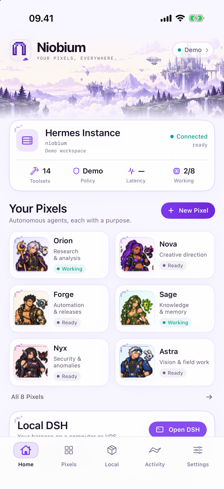
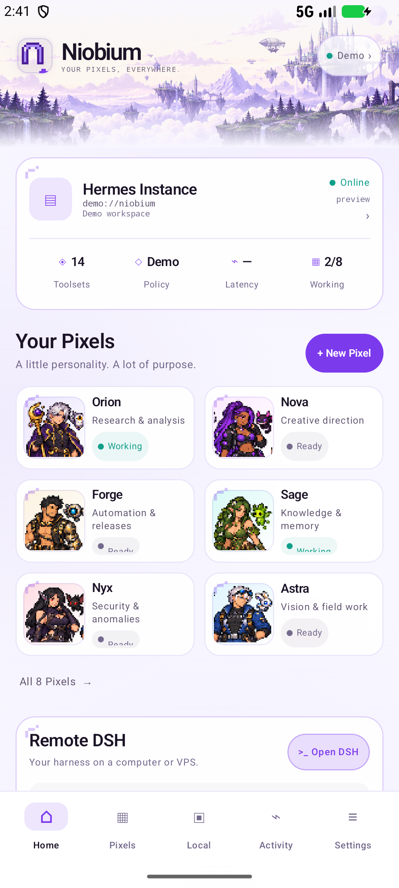

# Niobium

**Your pixels, everywhere. By [WCKD.ai](https://wckd.ai).**

A native iPhone, iPad and Android command deck for the Hermes agent on your
computer or VPS. Pixels are persistent Hermes profiles with their own voice,
memory, model, tools and creature companions.

**Public release: 1.1.0. v2 is in development.** Full Hermes parity is the target;
it is not finished. The current scope is in [PLAN.md](PLAN.md), the implementation
audit is in [docs/HERMES-PARITY.md](docs/HERMES-PARITY.md), and the work is tracked
in [Plane](https://app.plane.so/wckd/projects/2fbcf987-20de-43dc-80ac-0a6bab7ec03a/issues/).

 

## The app

Five tabs: **Home · Pixels · Local · Activity · Settings**.

- **Home:** lavender pixel landscape, gateway status and measured round trip,
  compact roster, and an honest local/remote harness entry.
- **Pixels:** persistent Bot Chats, rooms, @mentions and the Pixel workshop.
- **Local:** an embedded Alpine/iSH DeepSeek Harness in the iOS full build;
  remote DSH on both platforms.
- **Activity:** messages, tools, approvals and background results.
- **Settings:** gateway, appearance, skills, MCP inventory and runtime controls.

Chat includes photos, dictation, model/reasoning selection, stored sessions, usage,
routines, approval/clarify UI and companion work. Subagent monitoring, transcript
tails, steering and interruption use real Hermes RPCs. A queued correction is
reported as queued.

## Pixel workshop

Every New Pixel entry opens the same **describe → design → review → create**
flow. [bot-build.md](bot-build.md) is the source skill.

The builder asks the gateway for its installed tools and skills, generates a
validated PixelSpec, and previews the adult character, companion, detailed
operator briefing and access. Network, shell and files are reviewed before
creation. Invalid or unavailable model output becomes a clearly labelled local
template.

Creation pins the reviewed toolsets and skills, disables inherited MCP servers,
keeps host command approvals manual and stores the versioned PixelSpec in
profile metadata. Model credentials are inherited from the default profile.
Connector requests need separate account authorization. Workspace and network
isolation are configured on the Hermes host.

Appearance edits are saved to Hermes with metadata revision checks and restored
when the roster refreshes. An incomplete setup is reported without silently
creating a second profile.

## Characters and companions

Eight original adult fantasy/cyborg characters, with a playful, mischievous
edge. Human characters are 18+; styling is mature and non-explicit.

The app caches **48×48** portraits and displays them with nearest-neighbour
interpolation. New character recipes combine body, palette, hair, face, outfit
and accessory layers; their rendering remains experimental and needs more
visual polish than the authored cast. Named creature companions represent bounded delegation;
they do not simulate task completion.

[Art and prompts](brand/art-provenance.json) ·
[Design reference](docs/reference-dashboard.png)

## Build and check

Android requires JDK 17 and the Android SDK:

~~~sh
cd android
./gradlew :app:testDebugUnitTest :app:assembleDebug
~~~

The Hermes-only iOS target excludes the Linux root filesystem:

~~~sh
cd ios
xcodegen generate
xcodebuild -project Niobium.xcodeproj -scheme Niobium \
  -destination 'generic/platform=iOS Simulator' CODE_SIGNING_ALLOWED=NO build
~~~

The full local-DSH target is a separate project. Do not regenerate it with
XcodeGen. See [ios/README.md](ios/README.md) for the submodule/rootfs prerequisites.

Pure Swift validation checks:

~~~sh
swiftc ios/Sources/Niobium/PixelSpec.swift tools/check-pixel-spec.swift \
  -o /tmp/niobium-check-pixel-spec
/tmp/niobium-check-pixel-spec
~~~

Website:

~~~sh
node site/build.mjs
node site/check.mjs
~~~

The rebuild has passed 38 Swift PixelSpec checks, four Android test cases,
Android debug/release builds and both iOS simulator build variants. Native Home and
Pixel-review captures are in [screenshots](screenshots/README.md). These checks
do not establish end-to-end parity with a live, provider-backed Hermes install.

## Current limits

Native connector authorization, memory editing, project/workspace management,
complete file/PDF support, durable replay/outbox handling and several room/busy
controls remain incomplete. Android has remote DSH; an embedded Android Linux
runtime is not implemented. Mobile background sockets and push delivery are not
provided.

## Site and licenses

[niobium.sh](https://niobium.sh) uses the shared WCKD web design and is deployed
with Cloudflare Workers Static Assets from this repository. Public downloads
remain on the [1.1 release](https://github.com/wckdboy/niobium/releases/tag/v1.1.0).

Android is MIT. The iOS full build combines GPLv3 components. Niobium is
independent of Hermes/Nous Research and DeepSeek; see [NOTICE](NOTICE) and
[LICENSE](LICENSE). Legacy v1 notes remain in [docs/README-v1.md](docs/README-v1.md).

[Expanded test suite](docs/TESTING.md) · [Hermes update watch](docs/HERMES-UPDATES.md) ·
[Android local-runtime decision](docs/ANDROID-DSH.md)
