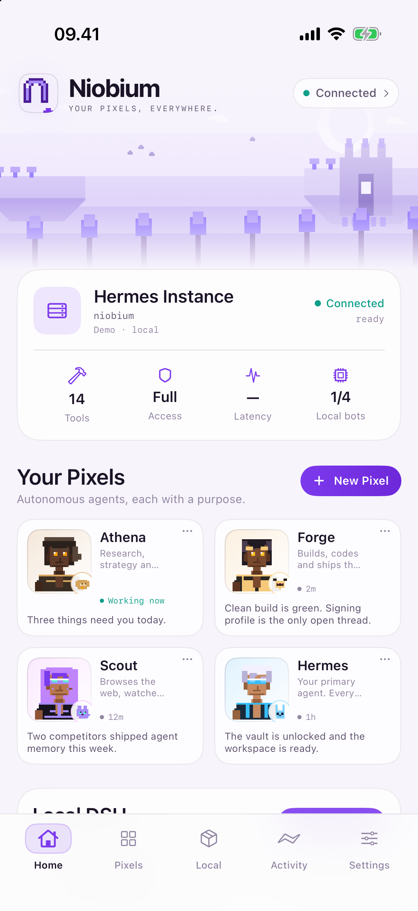
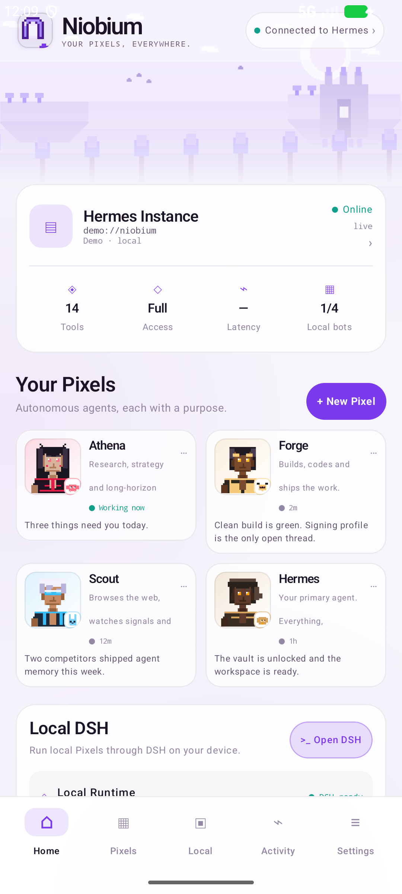
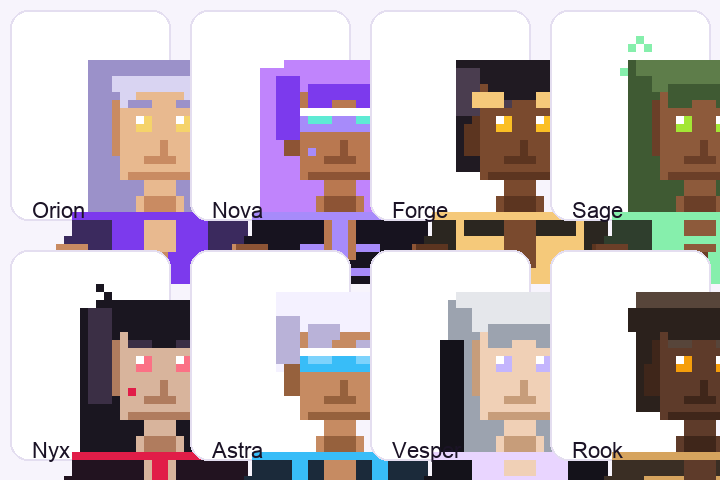

<p align="center">
  
</p>

# Niobium

**By [WCKD.ai](https://wckd.ai). Your pixels, everywhere.**

Niobium is the pocket command deck for a self-hosted Hermes gateway: a fast native
iOS/iPadOS and Android client with a mature 32×32 pixel cast, companions, and an AI
builder that creates a complete Pixel from one sentence.

> **Independent software.** Niobium is not affiliated with, endorsed by, or
> sponsored by xAI/Grok, Mausbot, Nous Research/Hermes, or DeepSeek. Hermes is a
> separate open-source project by Nous Research; DeepSeek Harness is a separate
> project. See [legal](https://niobium.sh/legal/).

**v1.1 is shipped.** v2 — the Home redesign, 32×32 cast, companions and AI builder —
is in active build on the `v2` branch. The plan is [PLAN.md](PLAN.md); the gateway
matrix is [docs/HERMES-PARITY.md](docs/HERMES-PARITY.md); v1 docs are archived at
[docs/README-v1.md](docs/README-v1.md).

 

## The deck

Five tabs: **Home · Pixels · Local · Activity · Settings**.

- **Home** — a pixel landscape, the Hermes instance card (host, access, tools,
  latency, local bots), a two-column cast with companions, and the Local DSH card.
- **Pixels** — the full roster, active rail, rooms, AI builder and new Pixel.
- **Local** — local DeepSeek Harness on iOS full builds; remote DSH on both.
- **Chats** — stored session browser, revision-fenced model picker, cast studio.
- **AI builder** — one sentence → personality, permissions, toolsets, connectors,
  character and companion; `bot-build.md` is the skill.
- **Activity** — turns, tools, approvals and the work in flight.
- **Settings** — appearance, connection, toolbox, harness, privacy.

Chat stays a focused full-screen surface with the character and companion in the
header, approvals, tools, rooms and routines.

## The cast

Eight adult characters — four men, four women — drawn as 32×32 sprites, each with
a cute monster companion. Mature cyber/fantasy styling is allowed; explicit content
and minors are not. Every Pixel can be chosen, randomised or built by AI.



## AI builder

`bot-build.md` is a portable agent skill. Describe a job in one sentence; the
builder returns a strict `PixelSpec` with personality, permissions, toolsets,
skills, connectors, character and companion. Niobium validates it, calls
`profiles.create` + `profiles.configure`, stores the cast/companion, and opens the
new Pixel. If no model is configured, it falls back to a labelled local template.

- Skill: [bot-build.md](bot-build.md)
- Site page: [niobium.sh/build](https://niobium.sh/build/)
- Builder code: `ios/Sources/Niobium/PixelSpec.swift`, `android/.../PixelBuilder.kt`

## Hermes + DSH

- Canonical WebSocket JSON-RPC gateway, text frames, Keychain/Keystore token.
- Canonical session payloads fixed: no `inline_images`, source `gui` or negotiated
  through `runtime.describe`; `gateway.capabilities` discovery.
- iOS full build embeds iSH-ARM64 + Alpine 3.21 + Node 22 + DSH and boots on demand;
  it is GPLv3, 82 MB and not an App Store build.
- Android (and iOS) can open a remote DSH web UI from a computer or VPS.

## v2 preview

Local preview artifacts (not a public release yet):

- `dist/Niobium-2.0-preview.apk` — SHA-256 `65ed41b4a892b79d2fd6fba189a571709ed9b188bcb7b9e993b4508f589ad584`
- `dist/Niobium-2.0-preview.ipa` (development-signed, not published) — SHA-256 `20dc83bef5d0351d1450de40bce92944448abb1f1bfeea64879de0d21b28460b`

The stable v1.1 release remains on GitHub. v2 is on the `v2` branch and PR #1.

## Build

### Android

```sh
cd android
./gradlew assembleDebug          # or assembleRelease
adb install -r app/build/outputs/apk/debug/app-debug.apk
```

### iOS Hermes client

```sh
cd ios
xcodegen generate
xcodebuild -project Niobium.xcodeproj -scheme Niobium \
  -destination 'platform=iOS Simulator,name=iPhone 18 Pro' build
```

### iOS full local DSH

```sh
git submodule update --init --recursive
cd ios
scripts/build-local-dsh.sh
xcodebuild -project NiobiumDSH.xcodeproj -scheme Niobium \
  -configuration Release -destination 'generic/platform=iOS' \
  -archivePath build/Niobium-DSH.xcarchive archive \
  -allowProvisioningUpdates DEVELOPMENT_TEAM=<YOUR_TEAM_ID>
```

## Repo

```
ios/            SwiftUI client, XcodeGen project, full iSH/DSH target
android/        Kotlin + Compose client
brand/          icon, cast, palette, tokens, guide
site/           WCKD static site + Wrangler config
skills/         bot-build.md
plane/          issue ledger (CSV)
docs/           parity audit and v1 archive
tools/          sprite/icon generators
```

## Site and project ledger

- Site: **[niobium.sh](https://niobium.sh/)** — deployed on Cloudflare Workers
  Static Assets from `site/`; `www.niobium.sh` route is registered (DNS
  propagation may lag).
- Plane: **[Niobium v2](https://app.plane.so/wckd/projects/2fbcf987-20de-43dc-80ac-0a6bab7ec03a/issues/)**
  in the `wckd` workspace; 24 issues imported from `plane/issues.csv`.

## License

iOS full build (iSH/DSH) is GPLv3; see [LICENSE](LICENSE) and [NOTICE](NOTICE).
Android is MIT; see [android/LICENSE](android/LICENSE). Site and brand assets are
WCKD.ai. No affiliation with the projects named above.

Built by [WCKD.ai](https://wckd.ai). Niobium, 2026.
