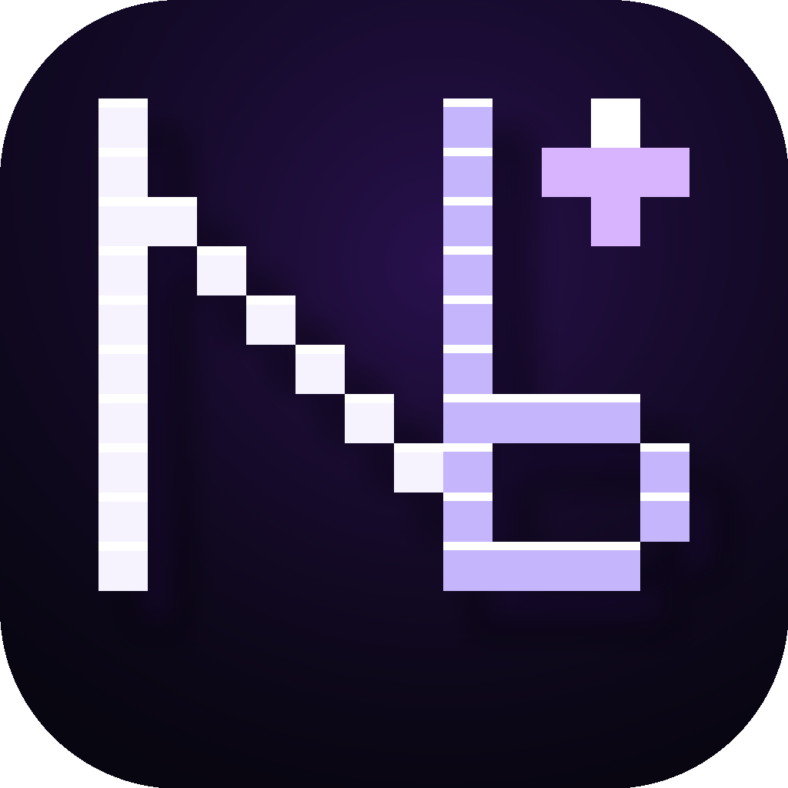
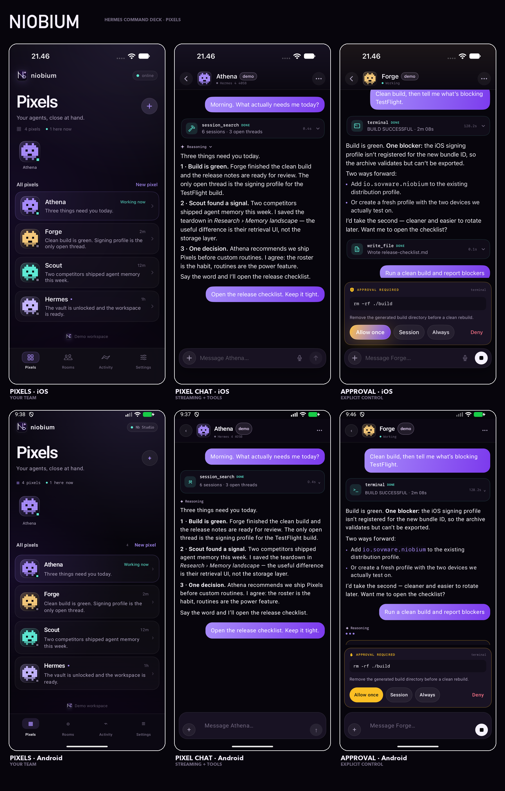
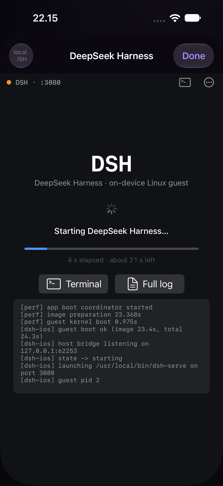

# Niobium

<p align="center">
  
</p>

**Nb · 41 · Hermes, in your pocket.**

Niobium is a native iOS and Android command deck for a self-hosted
[Hermes Agent](https://hermes-agent.nousresearch.com/). It connects directly to
your gateway and turns every Hermes profile into a **Pixel** — a small, durable
agent with its own memory, model and tools. One quiet, purple-lit place for the
roster, real tool calls, approvals, rooms and the work in flight.

On iOS/iPadOS, **1.1 adds an optional full DeepSeek Harness on the device**: a
bundled Alpine Linux guest, Node 22 and `@deepseek-ai/dsh`, served on loopback
and shown in the real DSH web UI. It is an independent harness, not a Hermes
profile; open **Settings → On device → DeepSeek Harness**.

There is no cloud in the middle. The agent, tools, memory, profiles and room
driver stay on your machine. Niobium is the window and the approve button.

<p align="center">
  <a href="screenshots/showcase.png"></a>
</p>

## Download

| Platform | Artifact | Notes |
| --- | --- | --- |
| Android 9+ | [GitHub Releases](https://github.com/wckdboy/niobium/releases/latest) | Signed release APK. Certificate SHA-256 `2f44d7e7316de46bf7d81a126bff456950a77df5c1e295afb753832aa1891b5d`. |
| iOS 18+ (Hermes only) | Build from source | [`Niobium.xcodeproj`](ios/Niobium.xcodeproj); no iSH, no guest image, no GPL code. |
| iOS 18+ (full local DSH) | Build from source | [`NiobiumDSH.xcodeproj`](ios/NiobiumDSH.xcodeproj); 82 MB IPA, GPLv3, requires the dsh-ios submodule and generated `root.tar.gz`. See [`ios/README.md`](ios/README.md). The development-signed IPA is kept out of the public repo because its provisioning profile embeds device identifiers. |

```sh
# Android
adb install -r Niobium-1.0.apk

# Verify an APK
JAVA_HOME=/opt/homebrew/opt/openjdk@17 \
  "$HOME/Library/Android/sdk/build-tools/36.0.0/apksigner" verify --print-certs \
  Niobium-1.0.apk
```

## The idea: Pixels

A Hermes profile is an isolated agent: its own config, memory, skills,
credentials and chat history. In Niobium that agent is a **Pixel**.

- **Pixels** is the home. Live pixels appear at the top; the full roster follows
  with the last thing each one said. Tap one to enter its canonical forever-chat.
- New pixels are created from the phone (`profiles.create` +
  `profiles.configure` with `ui_meta.hermes-bots`) and appear on every Hermes
  surface immediately.
- The backend's canonical session is still titled exactly `Bot Chat`; Niobium
  finds and resumes it with `session.list {title:"Bot Chat"}` so the phone, the
  desktop and the CLI share the same relationship.
- Every pixel has a deterministic 8×8 face tile. The pixel-art **Nb** mark and
  face system are the visual language, not decoration pasted on top.

## DeepSeek Harness, locally on iOS

The full DeepSeek Harness can run on an iPhone or iPad without a Mac, server or
jailbreak. Niobium embeds [iSH-ARM64](https://github.com/OpenMinis/ish-arm64),
boots a bundled Alpine 3.21 image with Node 22 and `@deepseek-ai/dsh`, supervises
`dsh-serve`, and presents the harness's own web UI in a WebKit surface.

- **Settings → On device → DeepSeek Harness** starts the guest on demand.
- A boot screen shows image import, kernel boot, server readiness and a live log;
  once ready, the DSH workspace, sessions, tools, permissions, settings and
  terminal are the stock harness UI.
- The server is loopback-only (`127.0.0.1`, automatically selected port).
- The guest image persists sessions, credentials and workspace; a new image
  migrates `~/.dsh` and the workspace on upgrade.
- iOS only, arm64. Apple Silicon simulator or a physical iPhone/iPad; x86_64
  simulators are not supported by the AArch64 guest.

<p align="center">
  
</p>

This is the excellent [DSH iOS/iSH integration by everettjf](https://github.com/everettjf/dsh-ios),
vendored as a pinned submodule. The full iOS app is GPLv3 because it links iSH.
It is a local development build, not an App Store submission.

## Features

### A quieter surface

Four tabs: **Pixels**, **Rooms**, **Activity**, **Settings**. The Toolbox lives
where you need it — inside a pixel's chat menu and in Settings — instead of
taking a permanent tab.

### Every tool, visible and controllable

- The Toolbox reads `tools.list` and shows every toolset, its tools, enabled
  state and search. Toggling uses `tools.configure` on the live session.
- Tool calls stream in as compact cards with input, output, duration and state.
- Dangerous commands produce a native approval card: **Allow once**, **Session**,
  **Always**, **Deny**. Clarify questions render as a native multi-question sheet
  on both platforms.
- The complete agent loop — terminal, files, browser, delegation, memory, skills,
  MCP, vision, web, cron and the rest — runs on the gateway. Niobium never
  re-implements or filters the toolset.

### Rooms

- A room is a shared conversation for 2–6 pixels. They can @mention each other,
  hand work off and bring the decision back to you.
- Rooms are listed, opened, created and messaged from the phone
  (`groups.create`, `groups.log`, `groups.send`). The gateway keeps working when
  the app is closed; Niobium catches up from the monotonic room log.
- Text-only in this release. Room-level approvals are not surfaced yet.

### Activity

- A small, live view of what is moving: working pixels, pending approvals and a
  recent feed of tool calls, replies and decisions.
- iOS also exposes per-pixel **Routines** backed by `cron.manage`; Android's
  routines UI is next.

### Input

- iOS: photo attachments (`image.attach_bytes`), on-device dictation via
  `SFSpeechRecognizer`, and stop (`session.interrupt`).
- Both: markdown, collapsible reasoning, streaming tool cards, and a floating
  composer that stays out of the way.

### Demo workspace

Every install can be explored without a gateway. The demo team is Athena, Forge,
Scout and Hermes, with a Launch Room, a Night Shift room, a real tool catalog
and a scripted approval. It is enough to evaluate the product before touching
Hermes config.

## Connecting

Niobium speaks the **Hermes TUI gateway** protocol: JSON-RPC 2.0 over
`/api/ws`, authenticated with the gateway session token in the `token` query
parameter. The HTTP leg probes `GET /api/status` first. This is the same protocol
the Hermes desktop uses, and it exposes Bot Mode, groups, tools and approvals
that the OpenAI-compatible API does not.

1. Start the Hermes backend:

   ```sh
   HERMES_DASHBOARD_SESSION_TOKEN="$(openssl rand -hex 32)" \
     hermes serve --host 127.0.0.1 --port 9119
   ```

2. In Niobium, enter the gateway URL and that token. The URL is the base of the
   server, e.g. `http://192.168.1.20:9119` or a Tailscale HTTPS name.
3. For remote access, bind Hermes to a reachable interface and configure its auth
   provider. A non-loopback bind engages the auth gate. Prefer HTTPS/Tailscale;
   Niobium permits cleartext for self-hosted LAN gateways.

On Android's emulator, `10.0.2.2` can be rejected by Hermes' host guard. Use
`adb reverse tcp:9119 tcp:9119` and connect to `http://127.0.0.1:9119`.

### Protocol used

| Area | Methods / endpoints |
| --- | --- |
| Connect | `GET /api/status`, `WS /api/ws?token=…`, `client.capabilities {server_requests:true}` |
| Pixels | `profiles.list`, `profiles.create`, `profiles.configure` |
| Chats | `session.list`, `session.create`, `session.resume`, `session.history`, `prompt.submit`, `session.interrupt` |
| Tools | `tools.list`, `tools.configure`, `image.attach_bytes` |
| Rooms | `groups.capabilities`, `groups.list`, `groups.create`, `groups.log`, `groups.send` |
| Schedules | `cron.manage` (iOS routines) |
| Server → client | `approval` → `{choice}`, `clarify` → `{answers}` |

Frames are JSON-RPC 2.0 **text** frames. The Hermes WebSocket transport rejects
binary frames; this was verified against the live gateway and fixed during the
bug pass. After `gateway.ready`, Niobium advertises
`client.capabilities {server_requests:true}` so approvals and clarify questions
arrive live instead of waiting out the gateway's deadline.

## Design

- **Palette:** near-black `#07050C`, ink `#0B0812`, chroma only from a
  `#A78BFA → #7C3AED` purple gradient and a very soft `#3B0764` bloom.
- **Mark:** a hand-built 16×16 raster of a porcelain **N** and lavender **b**,
  scaled nearest-neighbor. One pixel spark. It is the app icon, launch mark,
  Android adaptive foreground and in-app wordmark.
- **Pixels:** each agent has an 8×8 face tile driven by its accent colour. Teams
  stack the faces. No circles with initials.
- **Type:** system sans, tight display headings, sentence-case labels. Mono only
  for tool names and identifiers.
- Full tokens and rules: [`brand/tokens.json`](brand/tokens.json),
  [`brand/BRAND.md`](brand/BRAND.md).

## Architecture

```
Niobium
├── ios/          SwiftUI, Swift 6, iOS 18+, no third-party dependencies
│   ├── Sources/Niobium/
│   │   ├── Connection.swift      URLSession WebSocket JSON-RPC, Keychain
│   │   ├── AppStore.swift        roster, chats, events, groups, tools, demo
│   │   ├── Speech.swift          on-device dictation
│   │   └── Views/                Pixels, Chat, Rooms, Activity, Toolbox, Settings
│   └── project.yml               XcodeGen spec
├── android/      Kotlin, Compose Material 3, minSdk 28
│   └── app/src/main/java/io/sovware/niobium/
│       ├── GatewayClient.kt      OkHttp WebSocket JSON-RPC
│       ├── NiobiumViewModel.kt   state, roster, chats, events, groups, demo
│       ├── Chat.kt               DM + room transcripts, composer, approvals
│       └── Screens.kt            Pixels, Rooms, Activity, Toolbox, Settings
├── brand/        pixel mark, icon, tokens, guide
├── screenshots/  final iOS + Android captures
└── dist/         signed APK and IPA
```

Both apps implement the same state machine independently. No shared runtime
bridge, no JavaScript. Each stores the token in Keychain or an AES-GCM Keystore
key and renders with its native UI toolkit.

## Build

### Android

```sh
cd android
echo "sdk.dir=$HOME/Library/Android/sdk" > local.properties
gradle :app:assembleDebug
gradle :app:assembleRelease   # signed when keystore.properties exists
```

Release signing reads `android/keystore.properties` (`storeFile`,
`storePassword`, `keyAlias`, `keyPassword`). The properties and `.jks` are
git-ignored. R8 minification and resource shrinking are on; there are no
analytics or third-party SDKs.

### iOS (Hermes-only)

```sh
cd ios
xcodegen generate
xcodebuild -project Niobium.xcodeproj -scheme Niobium \
  -destination 'platform=iOS Simulator,name=iPhone 18 Pro' build
```

### iOS full build (embedded DeepSeek Harness)

```sh
git submodule update --init --recursive
cd ios
scripts/build-local-dsh.sh          # Alpine + Node 22 + dsh → Resources/root.tar.gz (~6 min)
xcodebuild -project NiobiumDSH.xcodeproj -scheme Niobium \
  -destination 'platform=iOS Simulator,name=iPhone 18 Pro' build

# archive
xcodebuild -project NiobiumDSH.xcodeproj -scheme Niobium -configuration Release \
  -destination 'generic/platform=iOS' -archivePath build/Niobium-DSH.xcarchive archive \
  -allowProvisioningUpdates DEVELOPMENT_TEAM=<YOUR_TEAM_ID>
```

`NiobiumDSH.xcodeproj` references the pinned `ios/ThirdParty/dsh-ios` submodule
through three symlinks (`ish-arm64`, `app`, `tests`). The generated guest image
is **not committed**; `scripts/build-local-dsh.sh` builds it inside the emulator
from the pinned Alpine and npm inputs. The standard `Niobium.xcodeproj` continues
to build without the submodule, the guest image, or GPL code.

App Store/TestFlight distribution is not configured. See the DSH project's
license notes before shipping iSH.

### Demo / screenshot flags

iOS (`simctl launch`):

```sh
xcrun simctl launch booted io.sovware.niobium --demo --no-splash
xcrun simctl launch booted io.sovware.niobium --demo --no-splash --bot athena
xcrun simctl launch booted io.sovware.niobium --demo --no-splash --bot forge --demo-tool
xcrun simctl launch booted io.sovware.niobium --demo --no-splash --room demo-launch
xcrun simctl launch booted io.sovware.niobium --demo --no-splash --tab activity
xcrun simctl launch booted io.sovware.niobium --demo --no-splash --toolbox
```

Android (`am start` extras):

```sh
adb shell am start -n io.sovware.niobium/.MainActivity --ez demo true
adb shell am start -n io.sovware.niobium/.MainActivity --ez demo true --es tab rooms
adb shell am start -n io.sovware.niobium/.MainActivity --ez demo true --es room demo-launch
adb shell am start -n io.sovware.niobium/.MainActivity \
  --ez demo true --es bot forge --ez demoTool true
adb shell am start -n io.sovware.niobium/.MainActivity --ez demo true --ez tools true
```

For live-gateway tests, pass `--es gateway <url> --es token <token> --es bot athena`
(or use the `NIOBIUM_GATEWAY` / `NIOBIUM_TOKEN` environment on the iOS
simulator).

## Bug pass and verification

The redesign shipped with a focused correctness pass:

- **WebSocket frame type.** The transport previously sent `Data` frames; Hermes
  only accepts text, so the socket closed immediately after `gateway.ready`.
  Both clients now send JSON-RPC as text.
- **Reconnect race.** A late failure/close from an old socket could clear the
  state of a newly opened socket. Both transports now bind callbacks to the exact
  socket instance and ignore stale events.
- **Duplicate connects.** A second connect can no longer race the first.
- **Multi-question clarify.** Android handled only the first question and did not
  recompose selections. It now collects every question with observable state.
- **Dead affordances.** Removed the non-working Android room overflow; chat
  overflow now opens the Toolbox / copies pixel details. The iOS tool row no
  longer nests a Toggle inside a Button.
- **Approval/tool status.** Tool failures are surfaced as failed rather than
  silently "done".
- **Error visibility.** Errors moved to the bottom so they do not cover the chat
  header, stay longer, and allow more lines.
- **Settings truthfulness.** iOS "Connect a gateway" now leaves demo mode and
  forgets the demo connection instead of hiding it behind a flag.
- **Lint/analyzer.** Android lint passes with zero errors (remaining warnings are
  Compose modifier/ordering preferences and the intentionally cleartext
  self-hosted gateway config); iOS `analyze` succeeds.

What was exercised:

- Connected to a real `hermes serve` (v2026.9.24) from the iOS simulator and an
  Android emulator; loaded the live four-profile roster and 60-toolset catalog.
- Booted the bundled DeepSeek Harness in the iOS simulator: Alpine guest imported
  and booted (~24 s first run), Node 22 / dsh `0.1.0-rc.7` started `dsh-serve` on
  port 3080, and the stock DSH web UI loaded inside Niobium.
- Opened the canonical `Bot Chat` for a profile on both clients. Android
  surfaced the expected agent-init/provider error because the isolated test
  backend had no model configured; iOS reached the same live session.
- Release APK installed and launched on an Android emulator; signed IPA installed
  on a physical iPhone.
- Demo flows: Pixels, chat, tool + approval, rooms, group chat, Activity,
  Toolbox, Settings, onboarding, on both platforms.

Not verified end-to-end: a model turn with provider credentials, multi-device
group delivery, TestFlight/App Store distribution.

## Known limitations

- **No background push.** Streaming works while the app is open; iOS reconnects
  on foreground. There is no APNs/FCM relay. Gateway routines still run while the
  phone sleeps.
- **One gateway per install.** The Hermes desktop supports a fleet; Niobium
  connects to one at a time.
- **Rooms are read/poll + send.** Room membership, text messaging and the log are
  supported; room-level approvals are not.
- **Android input parity.** Photo attachment and dictation are iOS-only in 1.0.
- **Routines are iOS-only** in 1.0.
- **Pixel avatars** are deterministic generated faces. Uploaded Hermes avatars are
  not fetched yet.
- **Cleartext HTTP** is allowed for self-hosted LAN gateways. Use HTTPS/Tailscale
  off-LAN. The token is a bearer credential for an agent with terminal access.
- **Local DSH is experimental and heavy.** First boot imports an 81 MB guest and
  can take 20–60 s; expect memory/CPU pressure. It is iOS-only, arm64-only, and
  the combined app is GPLv3. It is not an App Store target.

## Roadmap

- [ ] Room approvals from `driver_status.pending_actions`
- [ ] Android routines, photos and dictation
- [ ] Multiple gateways + union roster with `@name-device` handles
- [ ] Fetch and upload Hermes avatars into the pixel tile
- [ ] APNs/FCM notifications for approvals and turn completion
- [ ] Rewind/regenerate (`prompt.submit` truncation)
- [ ] Room attachments and thread-aware composer

## Security

- iOS stores the token as a Keychain generic password with
  `kSecAttrAccessibleAfterFirstUnlockThisDeviceOnly`.
- Android encrypts it with AES-256-GCM using a non-exportable Android Keystore
  key; only ciphertext is in SharedPreferences.
- No backend, account, analytics or telemetry. The only network destination is the
  gateway you enter.
- The agent runs with the gateway's privileges. Use a strong token, TLS and a
  network boundary.

## License

**The combined iOS app is GPLv3**, because it statically links iSH/iSH-ARM64
(GPLv3 plus the additional iOS terms) and includes the DSH iOS host code. See
[LICENSE](LICENSE) and [NOTICE](NOTICE), and the upstream
[dsh-ios](https://github.com/everettjf/dsh-ios) repository. The corresponding
source includes the pinned `ios/ThirdParty/dsh-ios` submodule and the guest-image
build script.

**Android** remains MIT-licensed: see [`android/LICENSE`](android/LICENSE). The
Hermes-only iOS target (`Niobium.xcodeproj`) does not compile or link iSH, but the
repository as a whole is distributed under GPLv3.

Hermes Agent is a separate project by Nous Research and is not bundled here.
DSH / DeepSeek Harness is a separate project by its contributors. Not affiliated
with Nous Research or DeepSeek.

Built by [Sovware](https://sovware.io).
