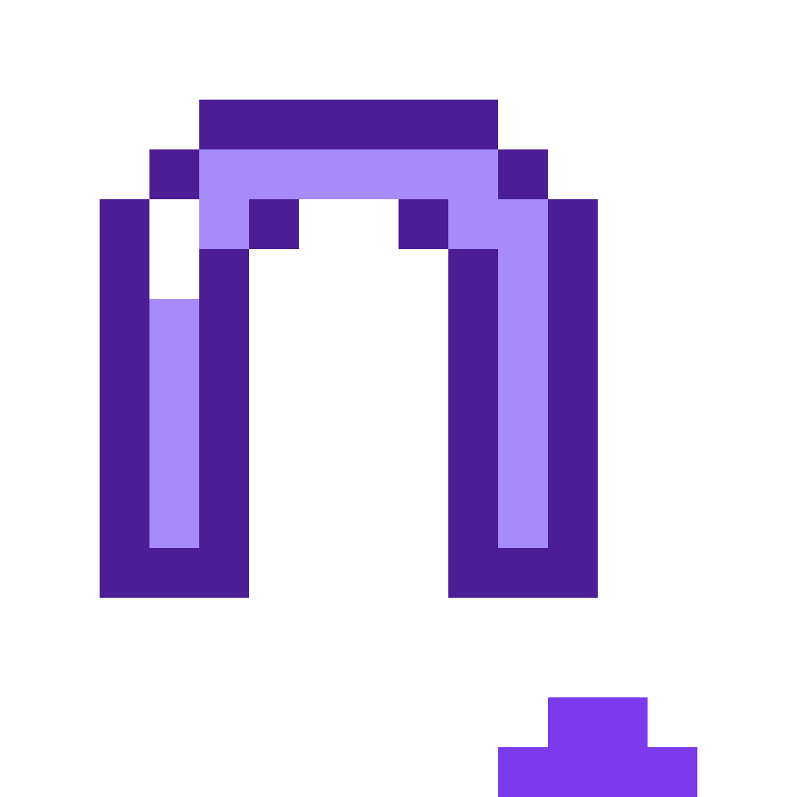
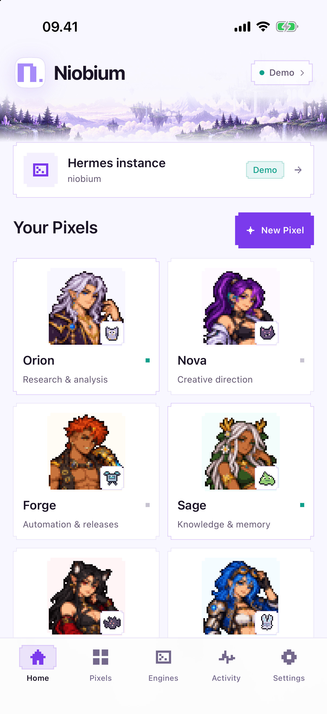
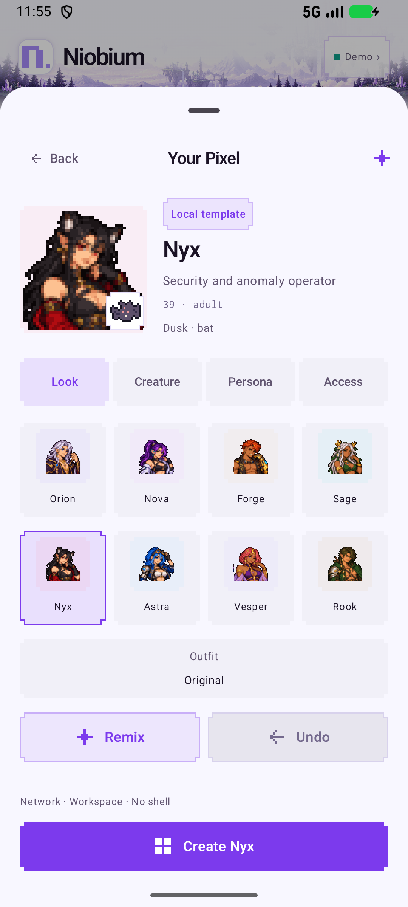
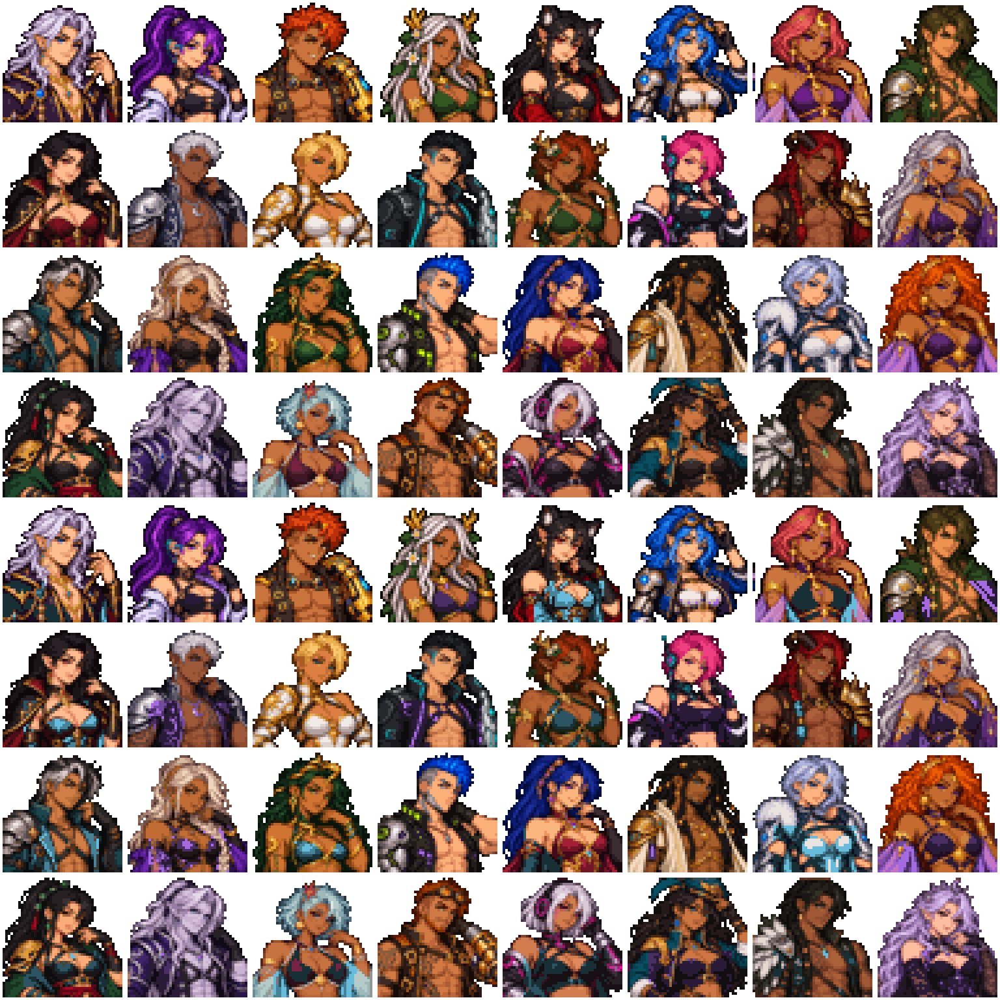

# Niobium

**Your pixels, everywhere. By [WCKD.ai](https://wckd.ai).**

A native iPhone, iPad and Android home for Pixels: your agents on a Hermes host
or in the on-device DSH engine, with their own personas, tools and companions.

**New release: [2.0.0-beta.7](https://github.com/wckdboy/niobium/releases/tag/v2.0.0-beta.7).** Full Hermes parity is the target;
it is not finished. The current scope is in [PLAN.md](PLAN.md), the implementation
audit is in [docs/HERMES-PARITY.md](docs/HERMES-PARITY.md), and the work is tracked
in [Plane](https://app.plane.so/wckd/projects/2fbcf987-20de-43dc-80ac-0a6bab7ec03a/issues/).

 

## The app

Five tabs: **Home · Pixels · Engines · Activity · Settings**.

- **Home:** lavender pixel landscape, gateway status and measured round trip,
  compact roster and one coherent native experience across providers.
- **Pixels:** persistent Bot Chats, rooms, @mentions and the Pixel workshop.
- **Engines:** select Hermes or on-device DSH. Local Pixels use the same native
  roster, workshop and chats. DSH runs behind the app; its web workspace lives
  under Advanced controls. Saved Hermes settings are retained when switching.
- **Activity:** messages, tools, approvals and background results.
- **Settings:** gateway, appearance, skills, MCP inventory and runtime controls.

Chat includes photos, dictation, model/reasoning selection, stored sessions, usage,
routines, approval/clarify UI and companion work. Subagent monitoring, transcript
tails, steering and interruption use real Hermes RPCs. A queued correction is
reported as queued.

## Pixel workshop

Every New Pixel entry opens the same **describe → preview → review → create**
flow. [bot-build.md](bot-build.md) is the source skill.

The first preview is a local template and appears without a model or image
request. Four short tabs separate Look, Creature, Persona and Access; the create
button stays visible. Optional AI refinement updates the persona while keeping
reviewed appearance and permissions. Its model call is bounded to 35 seconds.
Invalid or unavailable model output remains an honestly labelled local template.
The current engine's capabilities are checked before creating a profile;
newly available tools cannot silently broaden the review.

Creation pins the reviewed toolsets and skills, disables inherited MCP servers,
keeps host command approvals manual and stores the versioned PixelSpec in
profile metadata. Model credentials are inherited from the default profile.
Connector requests need separate account authorization. Workspace and network
isolation are configured on the Hermes host.

Appearance edits are saved to Hermes with metadata revision checks and restored
when the roster refreshes. An incomplete setup is reported without silently
creating a second profile.

Local creation writes reviewed DSH presets and keeps credentials in DSH app storage.
Group rooms and routines require Hermes. See [the native provider](docs/DSH-PROVIDER.md)
for the method mapping, execution limits and acceptance evidence.

## Characters and companions

Thirty-two adult fantasy/cyborg looks, with mature, non-explicit outfits and a
playful edge. Every human Pixel is 18+; default templates are 28–40.

Four art atlases provide exact **48×48** portraits with at most 32 colors per
base cell and hard alpha. Both native clients use the same pixels, garment
accents and cached renderers. Twelve transparent **16×16** creatures accompany
any look. Automatic selection follows the brief; the wardrobe has style filters,
search, surprise, color remix and undo. The first preview makes no model call.

Optional **AI atelier** designs new Pixel outfits and companion art using the
owner's OpenAI image key. Reference art and the brief go directly to OpenAI;
provider usage and retention apply. Jobs save a provider receipt for resuming,
and interrupted submissions are never silently posted again. Preview and accept
a design before it changes the Pixel. Indexed results remain small and portable;
opaque companion backgrounds are rejected. Appearance never grants agent access.

Older layered recipes remain readable with their original controls and optional
reduced-motion-aware blink.

The offline generator has eight role-specific working methods, voices and
creature temperaments; it handles word boundaries and honors explicit build
cues. Connected model generation uses the expanded bot-build skill and remains
labelled separately. Named creatures represent real bounded delegation; they
do not simulate task completion.

Rebuild/check the catalogs with
`python3 tools/portrait_looks.py [--check]`,
`python3 tools/character_engine48.py [--check]` and
`python3 tools/sync-pixel-personas.py [--check]`.
The generated art source and exact prompt are versioned; the macOS Swift baking
tool produces the canonical native atlas.

[Art and prompts](brand/art-provenance.json) ·
[Design reference](docs/reference-dashboard.png) ·
[Dashboard](docs/evidence/clean-pixels-ios-dashboard.png) ·
[Editor](docs/evidence/beta7-ios-workshop.png) ·
[Companions](docs/evidence/pixel-atelier-companions.png)

## Build and check

Shared runtime and contract checks:

~~~sh
npm ci --prefix runtime --ignore-scripts
node --test tests/*.test.mjs
~~~

Android requires JDK 17, SDK platform android-37.0 and NDK 30.0.16248370.
The verified Alpine image and pinned native packages are prepared automatically.

~~~sh
cd android
./gradlew :app:testDebugUnitTest :app:assembleDebug
~~~

The Hermes-only iOS target excludes the Linux root filesystem:

~~~sh
cd ios
xcodegen generate
xcodebuild -project Niobium.xcodeproj -scheme Niobium \
  -destination 'generic/platform=iOS Simulator' CODE_SIGNING_ALLOWED=NO build
~~~

The full local-DSH target is a separate project. Do not regenerate it with
XcodeGen. See [ios/README.md](ios/README.md) for the submodule/rootfs prerequisites.

Pure Swift validation checks:

~~~sh
swiftc ios/Sources/Niobium/PixelArt.swift ios/Sources/Niobium/PixelSpec.swift tools/check-pixel-spec.swift \
  -o /tmp/niobium-check-pixel-spec
/tmp/niobium-check-pixel-spec
~~~

Website:

~~~sh
node site/build.mjs
node site/check.mjs
~~~

The current source passes 50 iOS unit and six UI checks, 35 Android unit
and sixteen ARM64 emulator checks, 61 Node and 15 Python checks. Sixty-four
shared wardrobe fixtures verify both native renderers. All three CI jobs pass
at source 8a988cf; final Codex review has no findings, with nine earlier review
issues fixed and resolved. Greptile's trial quota prevents a fresh review.

The full iOS build 15 simulator test opens local Rooms, preserves an unfinished
model stream over backgrounding and restores actual DSH history after a cold
launch (134.594 seconds). Android verifies real tool-driven DMs, native questions,
room-clear cancellation, retained custom creatures and explicit remote/local
launch targets. Signed Android code 12 installs and cold-launches; runtime hashes,
corresponding sources and 16 KB ELF/ZIP alignment verify.

Full iOS build 15 archives successfully, with exact current runtime modules and
Release fixture exclusions. Distribution export and TestFlight upload are blocked
because Xcode reports “No Accounts.” Build 14 remains the latest accepted Apple
upload and physical iPhone acceptance; the paired phone is currently locked.
Real-account provider/image acceptance and full Hermes parity remain open. See
[beta.7 evidence](docs/evidence/beta7-release-validation.json).

## Connected workspaces

Beta.7 adds the 32-look wardrobe and optional AI atelier. Hermes and
DSH now own independent transports, conversations and approvals; changing the
selected workspace does not disconnect its peer. Hermes-only mode does not boot
Linux. Stop DSH explicitly to return to Hermes alone.

Local rooms keep separate provider sessions and a durable, attributed outbox.
Reviewed messaging access adds `list_pixels` and `message_agent` for real local
DMs. Room @mentions schedule bounded replies; eight deliveries per user message
and at most two per recipient stop loops. Unknown receipts are visible and never
replayed. Room approvals/questions use the native UI; clearing archives the
owned sessions. These rooms belong to their selected engine; cross-engine rooms
are not bridged. iOS may suspend local work in the background.

## Current limits

Native connector authorization, memory editing, project/workspace management,
complete file/PDF support, durable replay/outbox handling and several room/busy
controls remain incomplete. Android local DSH is a beta; provider-backed and
physical/16 KB device acceptance remain. The native workshop creates real DSH
presets and the loopback model integration test passes. Real-account provider
acceptance and actual delegation remain. Mobile gateway push delivery is not provided.

## Site and licenses

[niobium.sh](https://niobium.sh) uses the shared WCKD web design and is deployed
with Cloudflare Workers Static Assets from this repository. The
[2.0 beta release](https://github.com/wckdboy/niobium/releases/tag/v2.0.0-beta.7)
includes the signed Android APK, corresponding runtime sources, metadata and
checksums. Full iOS 2.0 (15), ai.wckd.niobium, is compiled and validated; its export
and TestFlight upload await Apple account sign-in in Xcode. Build 14 is the latest
accepted Apple upload. Tester availability remains unverified. The last stable release is
[1.1](https://github.com/wckdboy/niobium/releases/tag/v1.1.0).

The Android UI is MIT; bundled PRoot/Alpine components retain their GPL/LGPL/BSD licenses. The iOS full build combines GPLv3 components. Niobium is
independent of Hermes/Nous Research and DeepSeek; see [NOTICE](NOTICE) and
[LICENSE](LICENSE). Legacy v1 notes remain in [docs/README-v1.md](docs/README-v1.md).

[Expanded test suite](docs/TESTING.md) · [Hermes update watch](docs/HERMES-UPDATES.md) ·
[Android local-runtime decision](docs/ANDROID-DSH.md)
